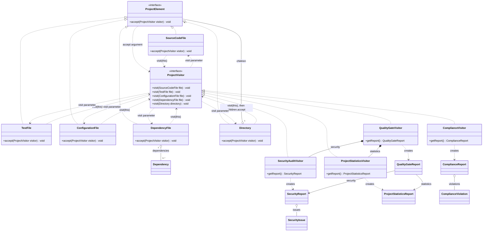
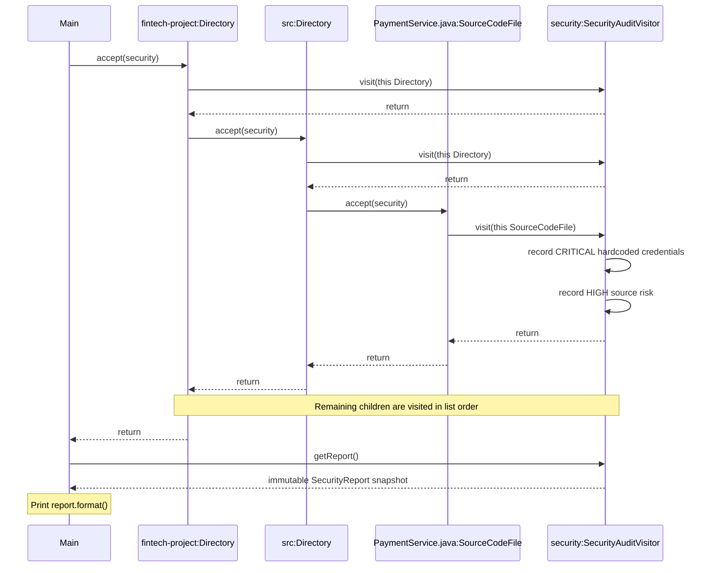

# UML diagrams

These Mermaid diagrams describe the implementation through stage 7. Concrete elements and reports are Java records. Fields are abbreviated to focus on Visitor relationships. GitHub renders the diagrams directly.

## Class diagram

Each concrete visitor implements all five `visit` overloads declared by `ProjectVisitor`. `Directory.accept` owns traversal; visitor directory methods do not traverse children. Aggregation shows that immutable elements and dependencies may be shared between trees.

## Sequence diagram

This shows the security audit of `PaymentService.java` in the demo. Other children are omitted for readability.

The first dispatch selects the concrete element's `accept` method. Inside it, `this` has a concrete type, selecting the matching `visit` overload. Runtime dispatch selects that method on the concrete visitor.
